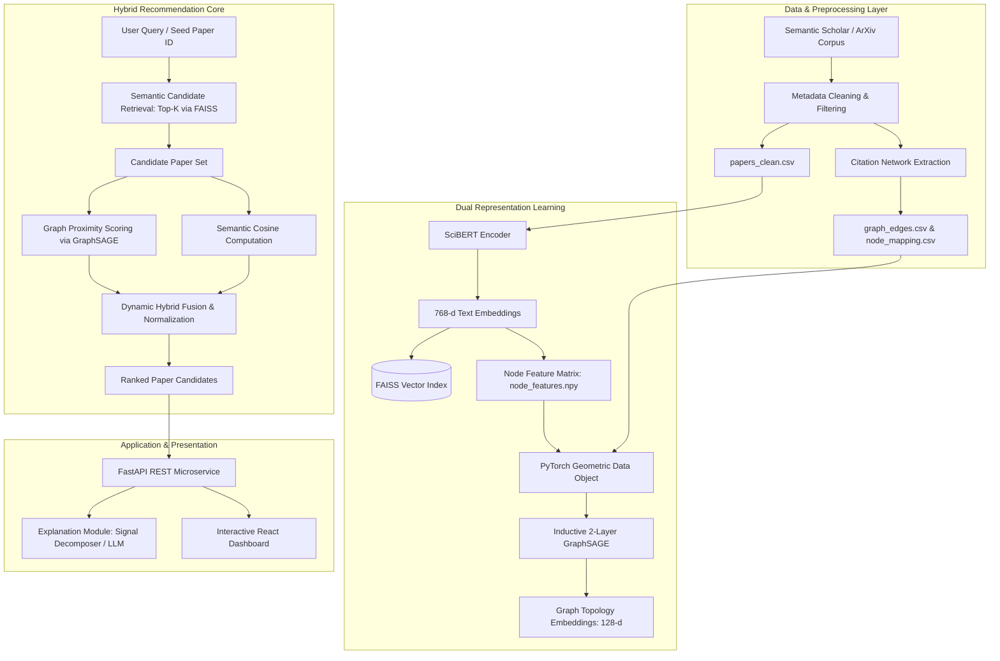

# 🏗️ System Architecture

## System Stages Breakdown

### 1. Offline Preprocessing & Indexing
- Ingestion of corpus metadata (abstracts, titles, years, citation links).
- Generating dense 768-d text vectors using fine-tuned scientific transformer `allenai/scibert_scivocab_uncased`.
- Indexing normalized vectors into a high-throughput FAISS `IndexFlatIP` structure for sub-millisecond retrieval.
- Building the bipartite/directed citation graph converted into an undirected message-passing structure.

### 2. Graph Representation Learning
- Training an inductive GraphSAGE model on link prediction task using edge neighborhood sampling.
- Generating graph embeddings $z_v \in \mathbb{R}^{128}$ encoding both SciBERT content and 2-hop topological citation context.

### 3. Online Hybrid Retrieval & Ranking Pipeline
1. **Candidate Retrieval Phase (High Recall)**: Query string or target paper abstract is embedded via SciBERT and matched against the FAISS index to generate top $N$ candidates (typically $N = 50$ to $100$).
2. **Graph Affinity Phase (Topological Precision)**: For each candidate, evaluate graph affinity with the target paper or topic centroid using GraphSAGE node representations.
3. **Score Fusion**:
   $$S_{final}(p) = \alpha \cdot S_{semantic}(p) + (1 - \alpha) \cdot S_{graph}(p) + \lambda \cdot P_{citation}(p)$$
   *(with graceful degradation for out-of-graph papers)*.

### 4. Interactive Interface
- Provides search-as-you-type, paper details modal, interactive radar/bar charts decomposing semantic vs. citation contributions, and human-readable explanations.

---
Back to [[Index]] | Next: [[Data Pipeline & Workflow]]

