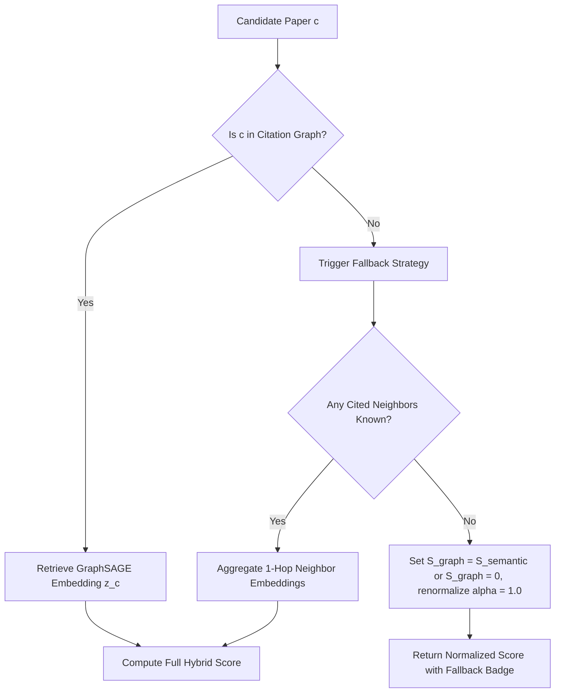

# 🧮 Hybrid Ranking & Score Fusion

## 1. Multi-Signal Formulation
The core recommendation score combines three complementary signals for candidate paper $c$ given query/seed paper $q$:

$$S(q, c) = \alpha \cdot S_{semantic}(q, c) + (1 - \alpha) \cdot S_{graph}(q, c) + \beta \cdot P_{citation}(c)$$

### Signal Components:
1. **Semantic Similarity ($S_{semantic}$)**:
   - Cosine similarity between SciBERT query vector and paper vector:
     $$S_{semantic}(q, c) = \frac{\vec{e}_q \cdot \vec{e}_c}{\|\vec{e}_q\|_2 \|\vec{e}_c\|_2} \in [0, 1]$$
   - Captures subject matter, topic alignment, and theoretical overlap.

2. **Graph Affinity ($S_{graph}$)**:
   - Cosine proximity between GraphSAGE topological embeddings:
     $$S_{graph}(q, c) = \frac{1 + \cos(\mathbf{z}_q, \mathbf{z}_c)}{2} \in [0, 1]$$
   - Captures community membership, co-citation distance, and citation likelihood.

3. **Citation Prior ($P_{citation}$)**:
   - Log-normalized global citation count to represent community consensus/impact without dominating recent papers:
     $$P_{citation}(c) = \frac{\log(1 + \text{citations}_c)}{\log(1 + \text{max\_citations})}$$
   - Weight $\beta$ is kept small (e.g., $0.05$ to $0.10$).

## 2. Dynamic Weighting & Parameter Defaults
- $\alpha \in [0, 1]$: Balance hyperparameter (default $\alpha = 0.60$, giving $60\%$ semantic and $40\%$ graph).
- The user can adjust $\alpha$ interactively via the frontend slider:
  - $\alpha = 1.0$: Pure semantic search (ideal for discovery across disparate disciplines).
  - $\alpha = 0.0$: Pure citation network proximity (ideal for mapping localized citation clusters).
  - $\alpha = 0.6$: Balanced hybrid recommendation.

## 3. Fallback Handling for Cold-Start / Out-of-Graph Papers
Real-world systems frequently encounter queries or papers that lack graph nodes.

When candidate paper $c \notin \mathcal{V}_{graph}$ or query $q$ is a free-text string without a pre-mapped graph node:
- **Free-text Query**: Compute centroid of top-$M$ semantic candidate graph embeddings as pseudo-query graph embedding $\mathbf{z}_{pseudo-q}$, OR compute standard hybrid ranking with candidate graph self-scores.
- **Out-of-Graph Candidate**: Fallback to pure semantic similarity ($S_{graph}(q, c) := S_{semantic}(q, c)$) and flag candidate with `fallback_applied: true`.

---
Back to [[Link Prediction & Training Strategy]] | Next: [[FastAPI Recommendation Service]]

